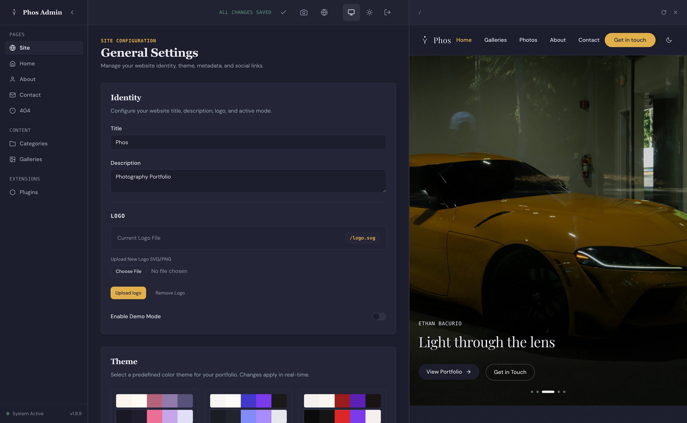

<p align="center">
  
</p>
<h2 align="center">phos (φῶς)</h2>

<p align="center">
  <a href="https://github.com/CyR1en/Phos/actions/workflows/docker-publish.yml"></a>
  <a href="https://github.com/CyR1en/Phos/pkgs/container/phos"></a>
  <a href="https://github.com/CyR1en/Phos/blob/master/LICENSE"></a>
  <a href="https://ko-fi.com/cyr1en"></a>
</p>

A static-site photography portfolio built with [Astro](https://astro.build) 6, [Tailwind CSS](https://tailwindcss.com) 4, and [Sharp](https://sharp.pixelplumbing.com/).

```bash
# Docker (production)
docker compose up -d

# Local development
npm install && ADMIN_PASSWORD=admin npm run dev
```

## Features

- **Photo pipeline** — drop images into category folders; thumbnails, blur placeholders, and masonry galleries with lightbox are generated automatically
- **Admin dashboard** (`/admin`) — edit site copy, manage photos, configure galleries, and run builds from a Preact SPA with auto-save
- **Plugin system** — extend the site with deploy-time Astro components at named insertion points
- **Dark mode** — three-state toggle (light / dark / auto), persisted and system-aware
- **Contact form** — SMTP-powered, configurable from the admin dashboard
- **Galleries** — DB-backed curated collections beyond folder-based categories

## Configuration and checks

| Environment variable | Purpose / default |
| --- | --- |
| `ADMIN_PASSWORD` | Admin login password; defaults to `admin` for development. Production refuses the default unless explicitly allowed. |
| `PUBLIC_SITE_URL` | Public origin for canonical/OG URLs, sitemap and admin request-origin checks; Astro defaults to `https://yourdomain.com`. Set this to your deployed URL. |
| `ADMIN_PORT` | Admin server port; `3001`. The Docker nginx and local Astro proxies target `3001`. |
| `LISTEN_PORT` | Docker nginx listening port; `8080`. |
| `PUID` / `PGID` | Docker appuser UID/GID and mounted-file ownership; both default to `1001`. |
| `ADMIN_ALLOW_DEFAULT=1` | Explicitly allow the default admin password in production; disabled unless set to `1`. |
| `PHOTOS_SOURCE` | Source category folders; `/photos` when present, otherwise `photos/` in the project. Dotfiles and dot-directories are ignored. |
| `DB_PATH` | SQLite database; project `config/site.db`, or `/config/site.db` in Docker. |
| `PHOTOS_CACHE_PATH` | Photo cache override; defaults to `photos-cache.json` beside the resolved SQLite database (Docker: `/config/photos-cache.json`). |
| `CONFIG_PATH` | Persisted JSON used only while the database holds no owner configuration yet (never migrated and never saved from the admin); defaults to project `config/site-config.json`, Docker to `/config/site-config.json`. Once the database has configuration it is authoritative. |
| `PHOS_SKIP_CONFIG_SYNC=1` | Skip the generator's SQLite-to-build-config sync, preserving synthetic/test config. |
| `PHOS_ALLOW_STALE_DIST=1` | Bypass only the test suite's dist freshness assertion; does not validate new build output. |
| `PHOS_ALLOW_NO_SHARP=1` | Explicitly skip pipeline tests when sharp cannot load; sharp is still required to generate photos. |

On the next generator run, a legacy `public/photos/.cache.json` moves to the resolved
cache path if that destination does not exist (including across volumes). If both
files exist, the generator keeps the destination and removes the legacy public cache.
Keep the cache outside `public/`; public `site-config.json` omits the entire SMTP block.

Run `npm test` for tests or `npm run check:full` to build and run all checks. The latter
uses `scripts/check-full.mjs` and works on Windows too; coordinate builds in a shared checkout.
It defaults an unset `PUBLIC_SITE_URL` to `https://phos.test` for OG checks; that verification
dist is not deployable. Rebuild with your actual public URL before deployment.

On a fresh clone, run `node scripts/discover-plugins.mjs && node scripts/write-active-theme.mjs`
before invoking `tsc` or `astro check` directly so the generated plugin manifest and
theme/config files exist. `npm run check`, `npm run dev`, and
`npm run build:site` run this step automatically.

## Images
**Admin page** `/admin`
<p align="center">
  
</p>

